# DevSecOps Project Report: student-management

**Module:** Labs: Cybersecurity and Coding (5NIDS6), Esprit
**Supervisor:** Nawel Hammami
**Team:** Youssef Bouaouina, *(partner name)*
**Validation:** Thursday 12/11/2026
**Repository:** https://github.com/youssefbouaouina/devopsNIDS (branch `devsecops/lab1-pre-commit`)

---

## 1. Objective

Start from the CI/CD pipeline built in the 4th-year DevOps module and turn it into a full
**DevSecOps** pipeline, adding security to each phase of the software lifecycle
(Development, Acceptance, Production, Operations), as presented in the course material.
The three course labs are part of the pipeline:

| Course lab | Where it runs in our pipeline |
|---|---|
| Lab 1: Pre-commit security hooks | Developer `git commit` hook **and** first Jenkins stage *Secrets Scan* |
| Lab 2: Retire.js | Jenkins stage *JS Dependency Scan (Retire.js)* |
| Lab 3: Gauntlt | Jenkins stage *Security Acceptance Tests (Gauntlt)* against the deployed app |

Following the course's advice ("Do less, but do it better"), we picked one well-integrated
tool per security activity. Every tool runs automatically in Jenkins, and every report is
archived with the build.

## 2. Starting point: the DevOps pipeline (4th year)

```
GitHub ─▶ Jenkins ─▶ Maven ─▶ SonarQube ─▶ Docker Hub ─▶ Kubernetes (Minikube) ─▶ Prometheus/Grafana
```

| Component | Role |
|---|---|
| Spring Boot 3 / Maven app (`student-management`) | REST API + MySQL |
| Jenkins (VM, Vagrant) | CI/CD orchestration (`Jenkinsfile`) |
| SonarQube | Code quality |
| Docker / Docker Hub | Image build and registry |
| Minikube | Deployment (namespace `devops`, MySQL + Spring app) |
| Prometheus + Grafana | Metrics and dashboards |

Everything runs in one Ubuntu VM described as code (`infra/vagrant`). Jenkins polls GitHub every
2 minutes, so a `git push` starts the pipeline automatically.

## 3. The DevSecOps pipeline

```
 ─────────────────────────── DEVELOPMENT ───────────────────────────    ACCEPTANCE   PRODUCTION   OPERATIONS
 Secrets ▶ Build ▶ SCA+IaC ▶ Retire.js ▶ SAST ▶ Build ▶ Image ▶ Push ▶ Deploy ▶ Gauntlt ▶ OWASP ZAP ▶ Monitoring
 scan             (Trivy)    (Lab 2)    (Sonar  image   scan          (K8s)   (Lab 3)    baseline     check +
 (Lab 1)                                 gate)          (Trivy)                                       attack demo
              every stage writes to reports/  ──▶  archived by Jenkins with each build
```

| Phase | Security activity (course) | Tool | Jenkins stage | Gate |
|---|---|---|---|---|
| Development (pre-commit) | Pre-commit security hooks | HMRC `security-git-hooks` via `pre-commit` | Secrets Scan (pre-commit) | Fails build |
| Development (commit) | Security Components Analysis (Java) | Trivy (`rootfs` on the jar) | SCA + IaC Scan (Trivy) | CRITICAL → UNSTABLE |
| Development (commit) | Infrastructure as Code analysis | Trivy (`config`) | SCA + IaC Scan (Trivy) | Report |
| Development (commit) | Security Components Analysis (JavaScript) | **Retire.js** | JS Dependency Scan (Retire.js) | HIGH → UNSTABLE |
| Development (commit) | Static code analysis (SAST) | SonarQube + Quality Gate | SonarQube Analysis (SAST) | Fails build |
| Development (commit) | Container security | Trivy (`image`) | Container Scan (Trivy) | CRITICAL → UNSTABLE |
| Acceptance | Security acceptance testing | **Gauntlt** (nmap + curl) | Security Acceptance Tests (Gauntlt) | Failure → UNSTABLE |
| Production | Security smoke tests | OWASP ZAP Baseline | Security Smoke Test (OWASP ZAP) | FAIL alerts → UNSTABLE |
| Production | Secrets management | Jenkins Credentials + Kubernetes Secret | Push / Deploy | n/a |
| Operations | Continuous monitoring | Prometheus alert rules + Grafana | Continuous Monitoring Check | Fails if not monitored |

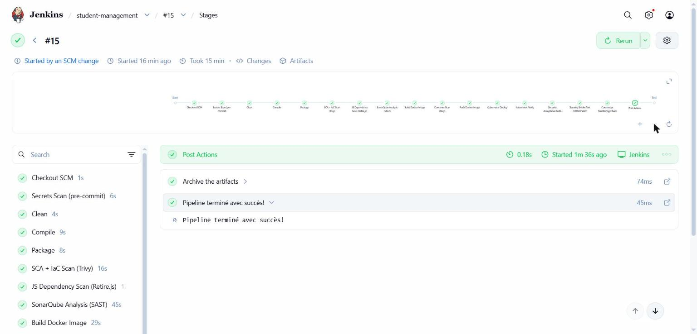
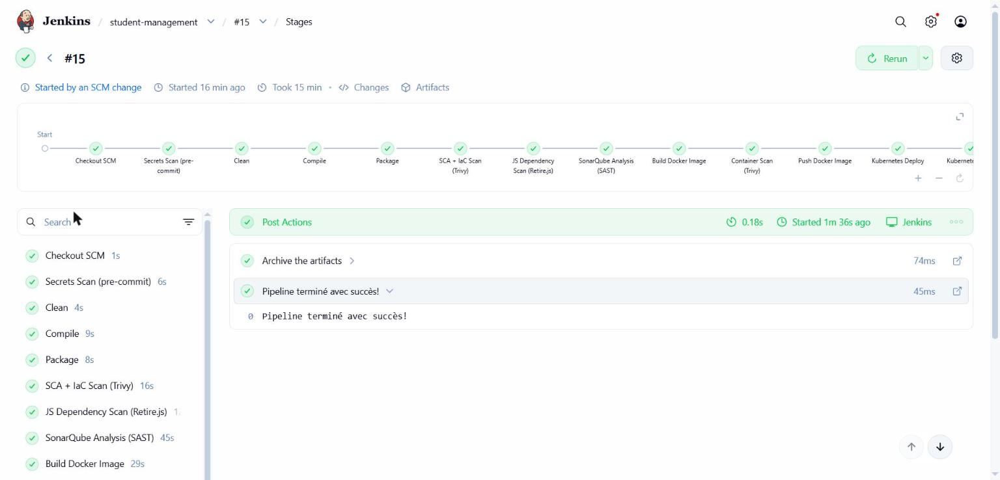
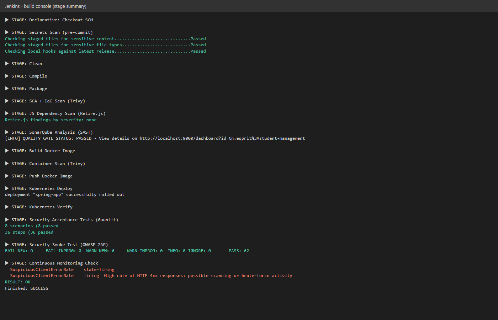

---

## 4. Phase 1: Development

### 4.1 Lab 1: Pre-commit security hooks

**Goal:** stop secrets (keys, passwords, tokens, key files) from ever reaching the repository.

**Tool:** the `pre-commit` framework with HMRC `security-git-hooks` (release 1.15.0):
- `secrets_filecontent`: flags sensitive strings (AWS keys, certificates, application secrets…)
- `secrets_filename`: flags sensitive file types (`*.pem`, `*.key`, …)
- `hooks_version_check`: checks the hooks are up to date

**Configuration:** `.pre-commit-config.yaml` at the repository root (plus `repository.yaml`, which
the HMRC hooks require). Lab evidence (`lab1-evidence/`) and course material are excluded, because
they deliberately contain the fake AWS key used for the test.

**Integration:**
1. *Developer side:* `pipx install pre-commit && pre-commit install`. Every `git commit` runs the hooks.
2. *Pipeline side:* the **first** Jenkins stage runs `pre-commit run --all-files` in a `python:3.12`
   container, so the rule also applies to commits made without the local hook.

**Test (as in the lab):** `touch fake.key.pem` and
`echo aws_secret_access_key = 1ye+Vark… > fake.aws.file`, then `git commit`. Both hooks
**Failed** and the commit was refused. The same files planted in the Jenkins workspace make the
stage exit with code 1. On the real code base, all hooks **Passed**.

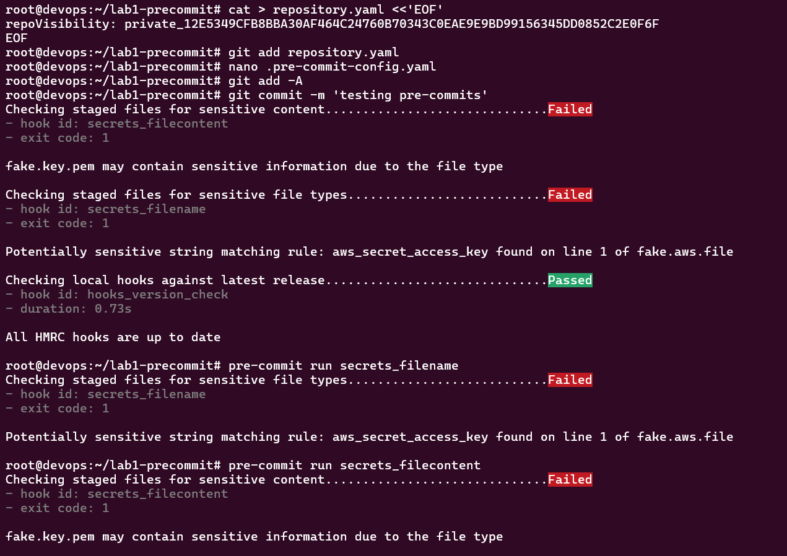
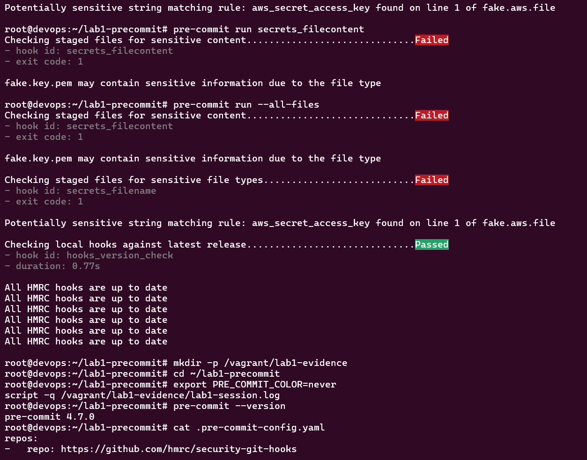
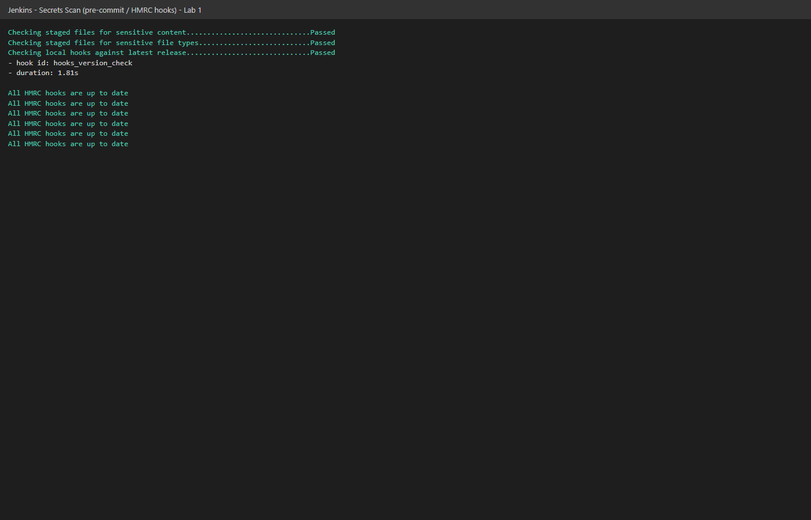

### 4.2 Security Components Analysis: Java dependencies (Trivy)

Retire.js (Lab 2) analyses JavaScript only, while the application is mainly Java/Maven. For
the Java libraries we applied the same practice with **Trivy**, which reads every library packaged
inside the Spring Boot fat jar. The same tool also covers IaC and container scanning.

**Configuration:** `security/trivy.sh` runs Trivy 0.65.0 in a container with a persistent
vulnerability-DB cache. Reports: `trivy-sca-report.html/.txt`. A second run with
`--severity CRITICAL --exit-code 1` marks the build **UNSTABLE** if an unaccepted CRITICAL CVE exists.

| Step | CVEs in the jar | CRITICAL | HIGH |
|---|---|---|---|
| Initial (Spring Boot 3.5.5) | 71 | 9 | 26 |
| Spring Boot 3.5.15 | 22 | 7 | 6 |
| + patched Tomcat 10.1.59, Jackson 2.21.7, commons-lang3 3.18.0, log4j 2.25.5 | **0 unaccepted** | 0 | 0 |

Two `spring-webmvc` CVEs (CVE-2026-47884, CVE-2026-47890) affect **Server-Sent Events** and are only
fixed in Spring Framework 7 (a Spring Boot 4 major upgrade). The application has no SSE endpoint
(checked in the source code), so the vulnerable code cannot be reached. They are recorded as
**accepted risks** in `.trivyignore`, with a justification and an expiry date (2027-01-31).

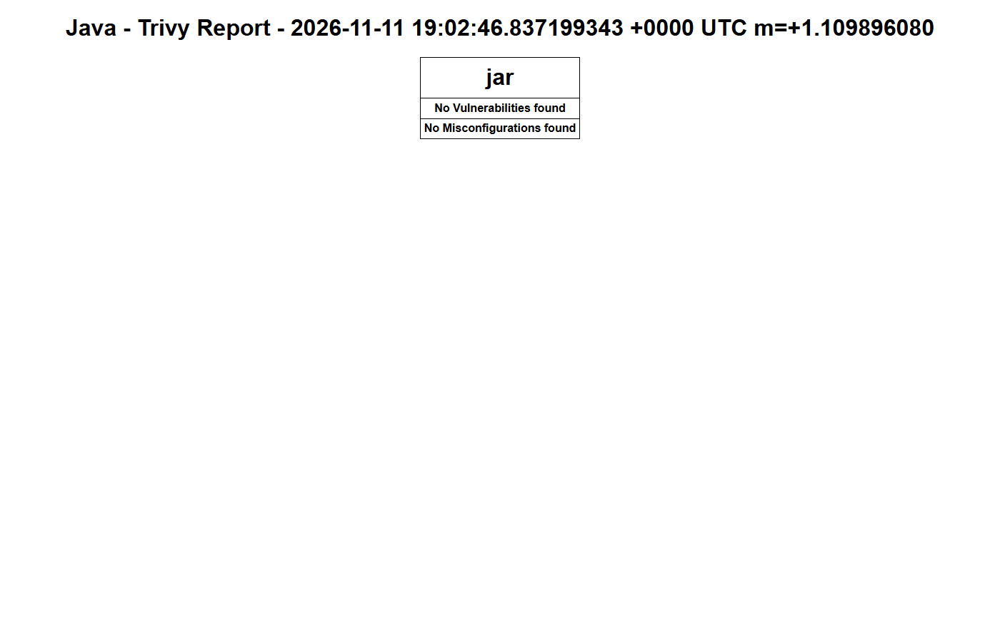
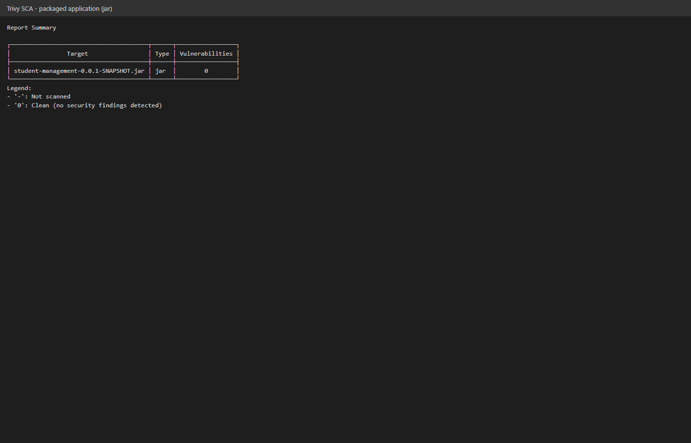

### 4.3 Lab 2: Retire.js (JavaScript libraries)

**Where the JavaScript is:** the application serves Swagger UI (API documentation), whose
JavaScript is bundled inside a webjar in the Spring Boot jar. `security/retire.sh` extracts every
`.js` file from the embedded libraries and runs **Retire.js 5** on them (`node:20` container).
Reports: `retire-report.json/.txt`. HIGH or CRITICAL vulnerable libraries mark the build UNSTABLE.

| Step | Library found | Retire.js result |
|---|---|---|
| Initial: springdoc 2.1.0 → Swagger UI 4.18.2 | **DOMPurify 3.0.1** | **HIGH**, CVE-2024-47875 (mXSS), plus others |
| springdoc 2.8.17 → Swagger UI 5.32.2 | DOMPurify 3.3.2 | 2 HIGH, 20 MEDIUM, 12 LOW |
| Swagger UI webjar pinned to **5.34.1** | DOMPurify 3.4.17 | **0 findings** |

Trivy's Java analysis did not see this issue: it is a JavaScript library hidden inside a Java
dependency. OWASP ZAP (Phase 3) independently reported the same "Vulnerable JS Library" before the fix.

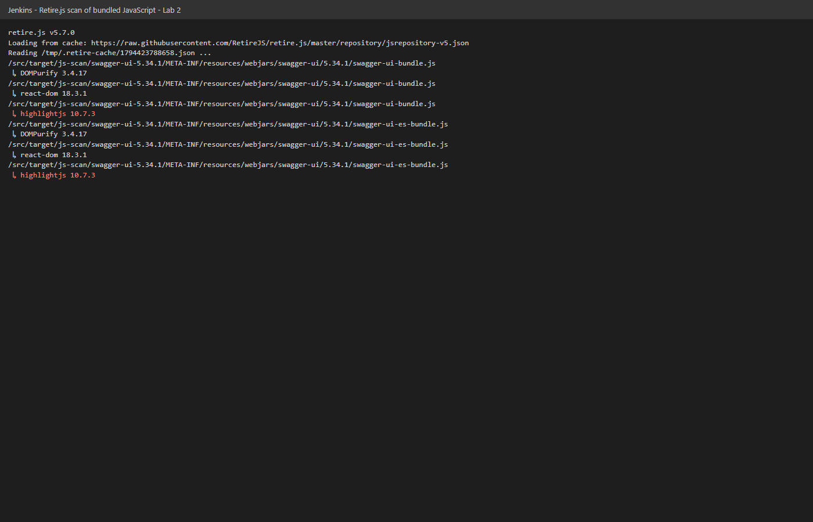

### 4.4 Infrastructure as Code analysis (Trivy config)

| File | Before | After |
|---|---|---|
| `Dockerfile` | 2 (1 HIGH: runs as root) | 1 LOW (no HEALTHCHECK; Kubernetes probes cover it) |
| `k8s/spring-app.yaml` | 18 (3 HIGH) | 2 MEDIUM |
| `k8s/mysql.yaml` | 16 (3 HIGH) | 16, accepted for the lab (the official MySQL image needs root at start-up) |

**Remediation:**
- `Dockerfile`: `eclipse-temurin:17-jre` instead of the JDK (smaller attack surface); a dedicated
  user `app` (uid 10001) with `USER 10001`.
- `k8s/spring-app.yaml`: `runAsNonRoot`, `runAsUser/Group 10001`, `seccompProfile: RuntimeDefault`,
  `allowPrivilegeEscalation: false`, `readOnlyRootFilesystem: true` (with an `emptyDir` for `/tmp`),
  `capabilities.drop: [ALL]`, CPU/memory requests and limits, `automountServiceAccountToken: false`.
  The hardened pod deploys and runs correctly.

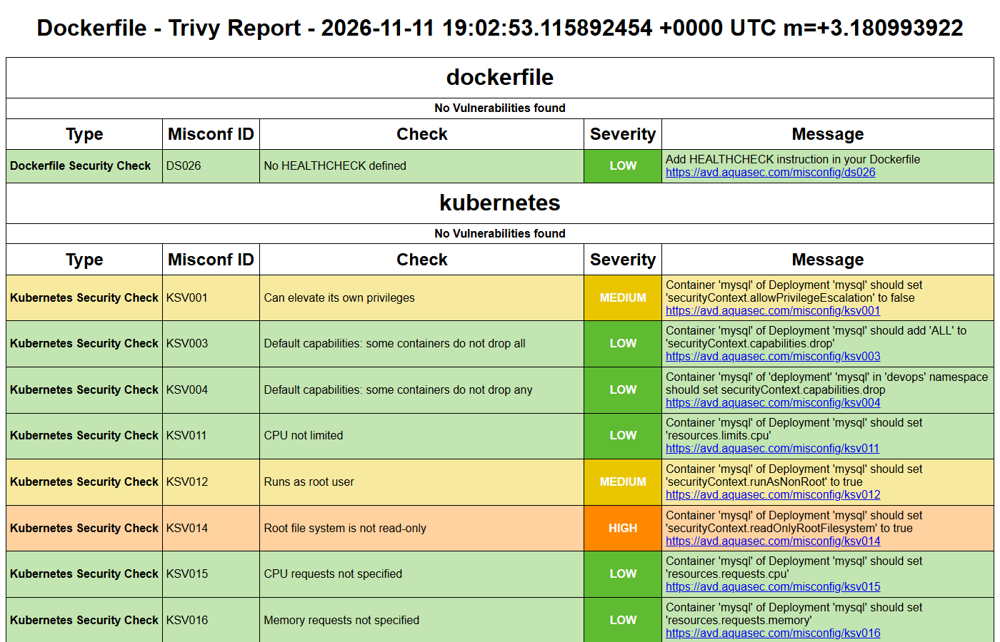

### 4.5 Static analysis (SAST): SonarQube with Quality Gate

SonarQube was already in the DevOps pipeline but only reported results. The build now **waits for
and enforces** the Quality Gate (`-Dsonar.qualitygate.wait=true`), so a failed gate stops the
pipeline before the image is built. Result: Quality Gate **Passed**.

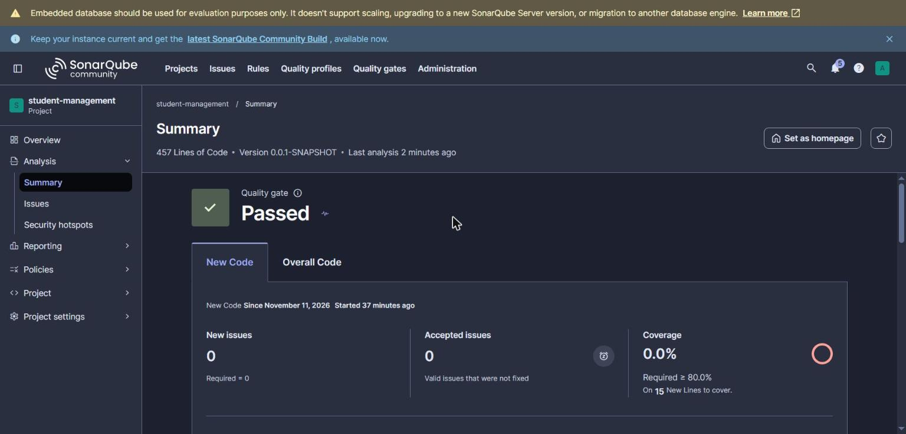

### 4.6 Container security: image scan (Trivy image)

The freshly built image is scanned **before** it is pushed to Docker Hub.

| | OS packages | Application libraries |
|---|---|---|
| Initial (`17-jdk`, Boot 3.5.5) | 70 CVEs (2 HIGH, 0 CRITICAL) | 71 CVEs (9 CRITICAL) |
| Final (`17-jre`, patched libraries) | 62 CVEs (2 HIGH, 0 CRITICAL) | 0 unaccepted CRITICAL |

The container runs as `uid=10001(app)`, verified with `docker run --entrypoint id`.

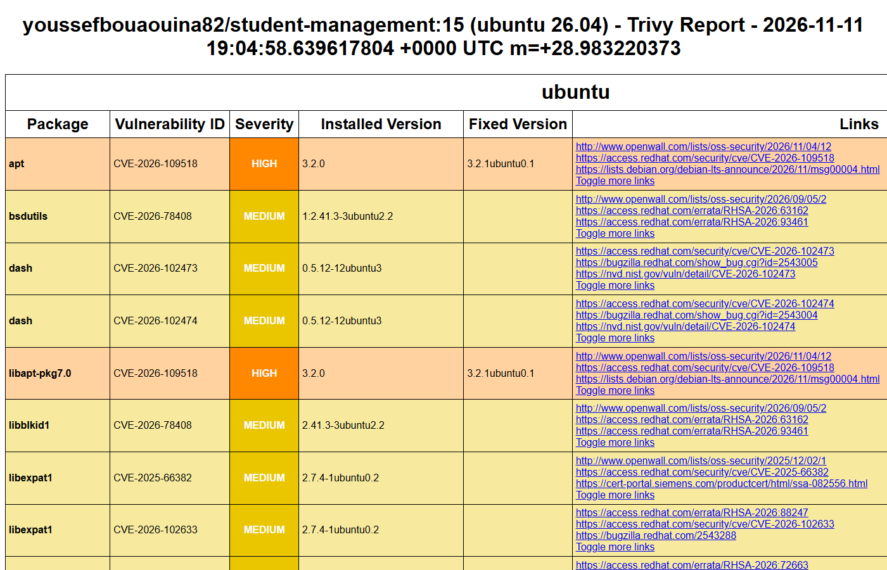

---

## 5. Phase 2: Acceptance

### 5.1 Lab 3: Security acceptance tests with Gauntlt

**Goal:** turn security requirements into executable BDD scenarios, run against the **deployed**
application after every deployment.

**Configuration:** `security/gauntlt/` holds a Dockerfile (Ruby 3.1, gauntlt 1.0.13, nmap, curl)
and two attack files:

| Attack file | Scenario | Expected |
|---|---|---|
| `nmap.attack` | Application port 8089 is reachable | `8089/tcp open` |
| `nmap.attack` | MySQL (3306/33060) is **not** exposed outside the cluster | ports not open |
| `http.attack` | Application is healthy | `/actuator/health` returns `UP` |
| `http.attack` | `/actuator/env` (configuration, secrets) is not exposed | 404 |
| `http.attack` | `/actuator/heapdump` (memory contents) is not exposed | 404 |
| `http.attack` | HTTP TRACE is disabled (Cross-Site Tracing) | not 200 |
| `http.attack` | Security headers are present (X-Frame-Options, X-Content-Type-Options, CSP) | headers present |
| `http.attack` | Invalid input does not leak a Java stack trace | no `Exception` in body |

**Integration:** the stage runs after the deployment, waits for the health endpoint, then runs
`gauntlt` in its container with host networking. Output: `reports/gauntlt-report.txt`.
**Result (build #15): 8 scenarios passed, 36 steps passed.**

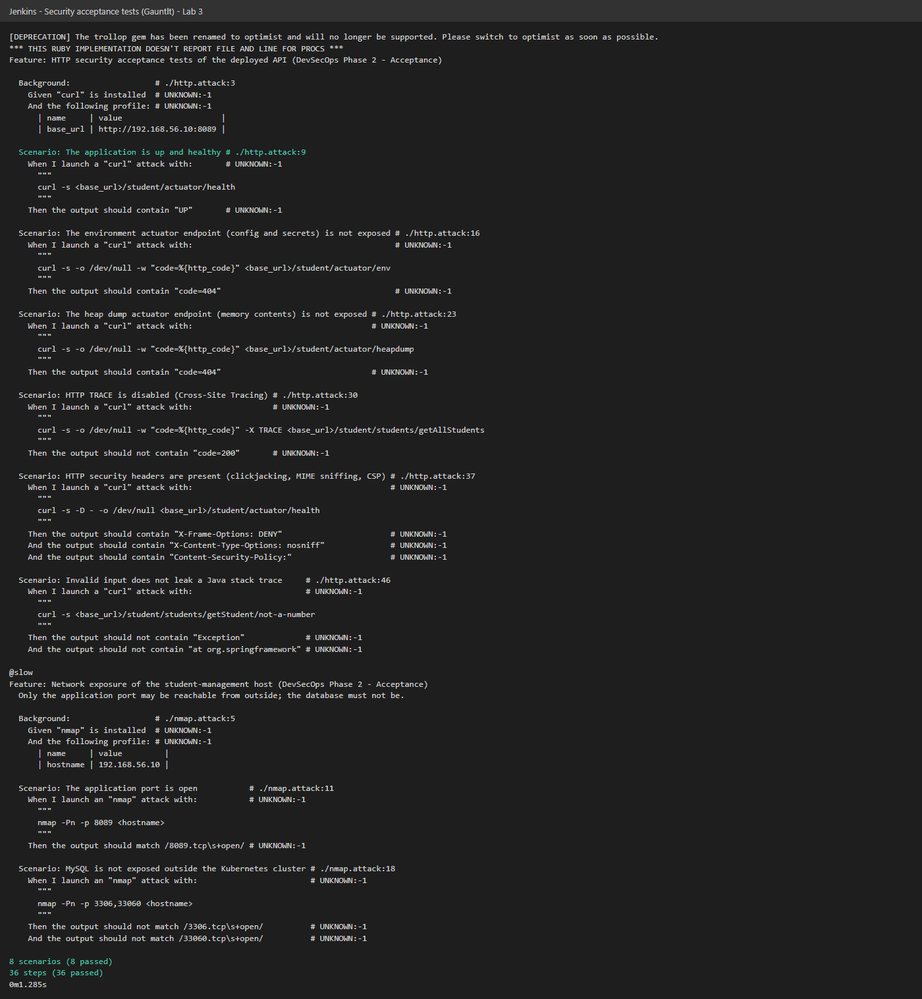

---

## 6. Phase 3: Production

### 6.1 Security smoke test: OWASP ZAP Baseline

**Goal:** after each release, quickly check the running application for obvious web
vulnerabilities (a security smoke test).

**Tool:** `zap-baseline.py` (OWASP ZAP) spiders the application from Swagger UI for 2 minutes and
applies passive rules (security headers, cookies, information disclosure, vulnerable JS…).
Reports: `reports/zap/zap-baseline-report.html|json|md`. FAIL-level alerts mark the build UNSTABLE.

**First run (build #2):** 0 FAIL, 11 WARN, 57 PASS. The warnings included *Vulnerable JS Library*,
missing *Content-Security-Policy*, *Anti-clickjacking*, *X-Content-Type-Options*,
*Cross-Origin-\** and *Permissions-Policy* headers, and *Application Error Disclosure*.

**Remediation:**
- `SecurityHeadersFilter` (servlet filter) adds CSP, `X-Frame-Options: DENY`,
  `X-Content-Type-Options: nosniff`, `Referrer-Policy`, `Permissions-Policy`,
  `Cross-Origin-Opener/Embedder/Resource-Policy` and `Cache-Control: no-store` to every response.
- `server.error.include-*=never`: no stack traces, exception names or messages in error responses.
- The vulnerable JS library was fixed by the Retire.js remediation (4.3).

**Final run (build #15):** **0 FAIL, 6 WARN, 62 PASS** (build #2 had 11 WARN and 57 PASS). Remaining alerts:

| Risk | Alert | Comment |
|---|---|---|
| Medium | CSP: `style-src 'unsafe-inline'` | Swagger UI needs inline styles; accepted for the documentation page |
| Medium | CSP header not set (1 URL) | The server root `/` (outside the `/student` application) answers Tomcat's default 404 |
| Low | Permissions-Policy not set (3 URLs) | Same root / static paths outside the application filter |
| Low | Timestamp disclosure | Unix timestamps in Swagger UI JavaScript (false positive) |
| Info | Modern Web Application, cache-related | Informational only |

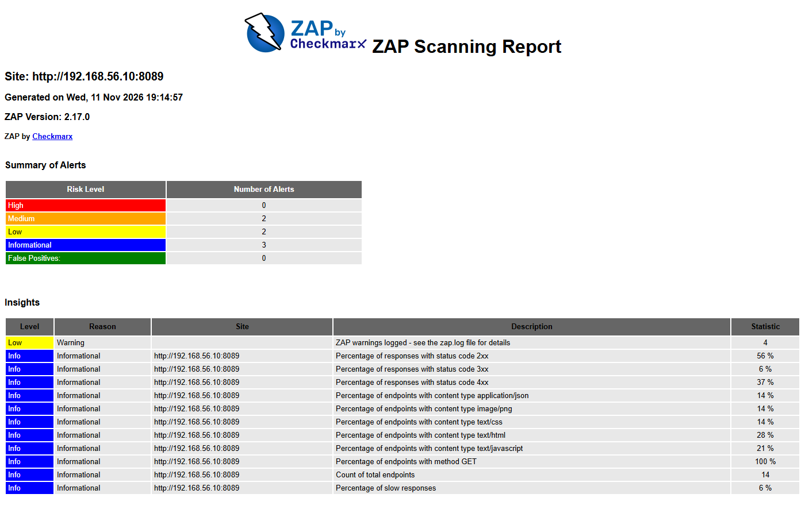

### 6.2 Secrets management

No secret is stored in the repository or the `Jenkinsfile`:

| Secret | Stored in | Used by |
|---|---|---|
| Docker Hub token | Jenkins credential `dockerhub-credentials` | Push stage (`--password-stdin`) |
| SonarQube token | Jenkins credential `sonar-token` | SAST stage |
| MySQL root password | Jenkins credential `mysql-root-password` → Kubernetes Secret `mysql-secret` | MySQL and Spring pods (`secretKeyRef`) |

Jenkins masks these values in the console log, and the pre-commit stage (4.1) blocks any new
secret from being committed.

---

## 7. Phase 4: Operations

### 7.1 Continuous security monitoring with Prometheus alert rules

Prometheus scrapes the application (`/student/actuator/prometheus`). We added security alert rules
(`infra/monitoring/alert-rules.yml`):

| Alert | Detects | Rule (summary) |
|---|---|---|
| `StudentAppDown` | Application unreachable (DoS, failed deployment) | `up == 0` for 1 min |
| `SuspiciousClientErrorRate` | Bursts of 4xx: scanning, fuzzing, brute force | 4xx rate > 0.2 req/s for 30 s |
| `ServerErrorRate` | 5xx errors under input or attack | 5xx rate > 0.1 req/s for 2 min |
| `HeapExhaustion` | Memory exhaustion / memory DoS | heap > 90% for 5 min |

**Pipeline stage *Continuous Monitoring Check*:**
1. Simulates an attack: about 100 seconds of requests to a non-existent admin login page
   (a scanner or brute-force pattern).
2. Queries the Prometheus API (`security/monitoring_check.py`) and records scrape-target health,
   the state of each security rule and the active alerts in `reports/monitoring-check.txt`.
   The stage fails if the application is not monitored.

**Result in build #15:** the simulated attack was detected. `SuspiciousClientErrorRate` went to
**FIRING** (4xx rate about 2.5 req/s, threshold 0.2), the Grafana dashboard shows the 404 spike, and
the stage ended with `RESULT: OK`.

`StudentAppDown` was also seen **firing** on the fresh cluster before the first deployment, which
shows that availability monitoring works.

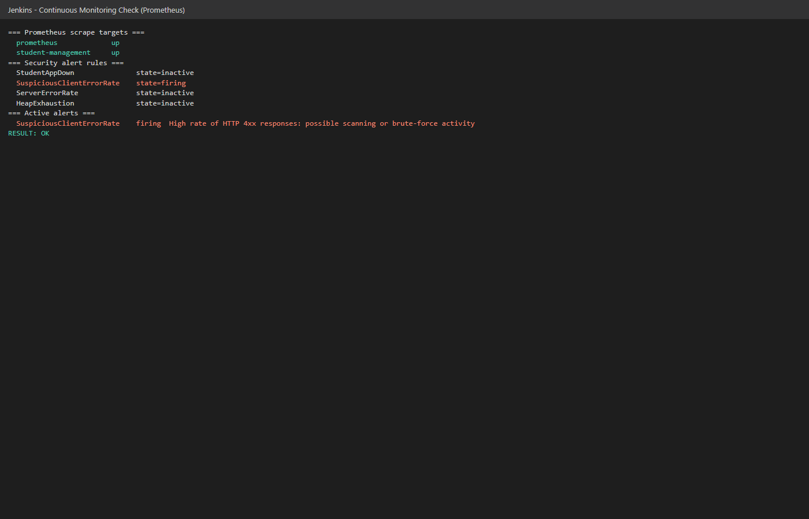
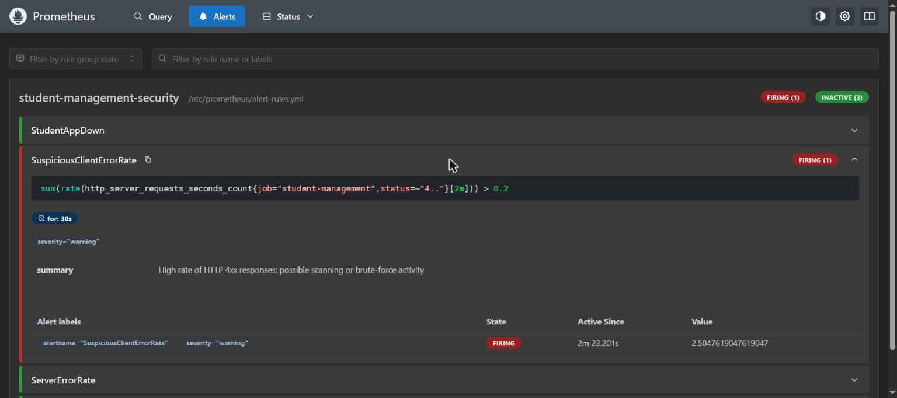
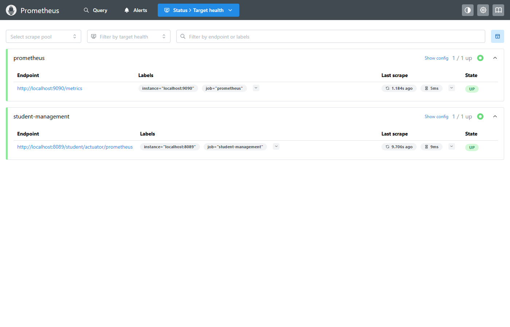
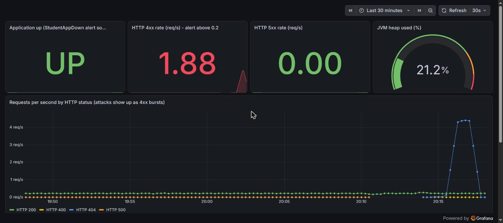

---

## 8. Reports produced by each build

| Report | Tool | Phase |
|---|---|---|
| `secrets-scan.txt` | pre-commit / HMRC hooks (Lab 1) | Development |
| `trivy-sca-report.html/.txt` | Trivy (Java SCA) | Development |
| `trivy-iac-report.html/.txt` | Trivy (IaC) | Development |
| `retire-report.json/.txt` | Retire.js (Lab 2) | Development |
| SonarQube project dashboard | SonarQube | Development |
| Grafana dashboard *DevSecOps Security Monitoring* | Grafana (`infra/monitoring/grafana/dashboards`) | Operations |
| `trivy-image-report.html/.txt` | Trivy (image) | Development |
| `gauntlt-report.txt` | Gauntlt (Lab 3) | Acceptance |
| `zap/zap-baseline-report.html/.json/.md` | OWASP ZAP | Production |
| `monitoring-check.txt` | Prometheus API | Operations |

All are archived by Jenkins (`archiveArtifacts 'reports/**'`) and downloadable from each build.
A copy of the final build's reports (build #15) and its console log is in `docs/evidence/build-15/`.

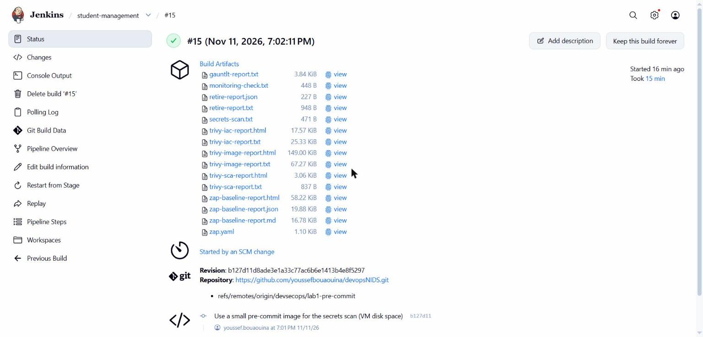

## 9. Problems met and how we solved them

| Problem | Solution |
|---|---|
| Retire.js only scans JavaScript, and the app is Java | Retire.js on the JS bundled in the jar (Swagger UI) + Trivy for the Java libraries |
| Gauntlt 1.0.13 does not run on recent Ruby; Debian 11 images are archived | Custom image on Ruby 3.1 (Debian 12) |
| Trivy timed out on the first image scan (vulnerability DB download) | Persistent DB cache + `--timeout 20m` |
| Security tools would need installing on the Jenkins VM | Every tool runs in a Docker container (`python`, `trivy`, `node`, `gauntlt`, `zap`) |
| VM disk 99% full: Jenkins executor went offline and SonarQube's Elasticsearch became read-only | Removed unused images, smaller pre-commit image (Alpine), restarted SonarQube |
| Polling every minute queued duplicate builds while the executor was offline | Polling every 2 minutes, queue cleared |

## 10. Limits and next steps

- **Spring Boot 4 migration** to remove the two accepted SSE CVEs (review date 2027-01-31).
- **MySQL hardening:** use a non-root MySQL image to fix the remaining IaC findings.
- **Base image:** 2 HIGH CVEs in Ubuntu packages with no fix yet; consider a distroless JRE image.
- **Authentication:** the API has no authentication. Spring Security would be the next
  application-level control, and ZAP could then run an authenticated scan.
- **SonarQube findings:** SonarQube reports security hotspots (e.g. persistent entities used as
  request bodies, rule java:S4684); request DTOs would remove them.
- **Alert routing:** connect Prometheus to Alertmanager (e-mail/Slack) so alerts reach the team.

## 11. How to run

1. `cd infra/vagrant && vagrant up` (Jenkins, SonarQube, Minikube, Prometheus, Grafana).
2. Jenkins: add the credentials `dockerhub-credentials`, `sonar-token`, `mysql-root-password`.
3. The job `student-management` (`infra/jenkins/student-management-job.xml`) builds on every push,
   or use **Build Now**.
4. Results: build page → *Artifacts* (`reports/`), SonarQube :9000, Prometheus :9090/alerts, Grafana :3000.

## 12. Final result (build #15)

| Stage | Result |
|---|---|
| Secrets Scan (Lab 1) | 3 hooks Passed |
| SCA + IaC (Trivy) | jar: 0 vulnerabilities; IaC: Dockerfile 1 LOW, spring-app 2 MEDIUM |
| JS Dependency Scan (Lab 2, Retire.js) | 0 findings |
| SonarQube | Quality Gate Passed |
| Container Scan (Trivy) | 0 CRITICAL (OS: 62, 2 HIGH unfixed upstream; jar: 0) |
| Deploy | hardened pod rolled out |
| Gauntlt (Lab 3) | 8/8 scenarios, 36/36 steps passed |
| OWASP ZAP | 0 FAIL, 6 WARN, 62 PASS |
| Monitoring | attack detected, alert FIRING, RESULT OK |
| **Pipeline** | **SUCCESS** (17 stages, 15 min) |
